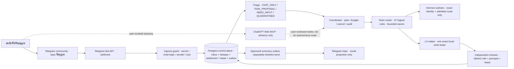

# Telegram Community Team Pilot

Status: `DESIGN_ONLY / CONNECTORS_DISABLED / RUNTIME_UNVERIFIED / PRODUCTION_HOLD`

เอกสารนี้รวบรวมคำขอที่เกี่ยวข้องจากบทสนทนานี้: ใช้หนึ่ง topic ใน Telegram community เดิม, รับข้อความที่ไม่มี @mention, ประสานทีม/agents, ให้ ChatGPT Web MCP เป็นที่ปรึกษา, รองรับ local write ภายใต้ lease, และประเมิน GhostClaw MCP, Remote Desktop Commander MCP กับ DWB MCP Studio แผนนี้ไม่ใช่หลักฐานว่า connector/runtime มีอยู่จริง และไม่เปิดสิทธิ์ให้เชื่อมต่อหรือทำ side effect

## ขอบเขตที่ตกลงสำหรับการออกแบบ

- Pilot เป้าหมายคือ **หนึ่ง topic ใน community เดิม**; ยังไม่มี chat ID, topic/thread ID หรือรายชื่อผู้มีสิทธิ์ที่ยืนยันแล้ว
- ChatGPT Web MCP เป็น **advisory ที่ผู้ใช้เรียกและอ่านผลเอง** ไม่ใช่ autonomous worker, API backend หรือบอตที่คุยกับ Telegram เอง
- Local source writes ทำได้ในอนาคต **เฉพาะเมื่อมี lease ที่ผูกกับ task, repo, worktree, paths, operations, principal และเวลาไว้อย่างแน่นอน** พร้อม checker อิสระ
- “รับคำสั่งโดยไม่ต้องแท็ก” หมายถึง classifier ตรวจ intent จากข้อความในขอบเขตที่อนุญาตได้ ไม่ได้หมายความว่าทุกข้อความเริ่มรัน agent หรือข้าม approval ได้
- 47 Ronin คือ logical roles ไม่ใช่ process 47 ตัว; all-team brainstorm ทำเป็นรอบ/ชุดย่อยภายใต้ worker limit ไม่ใช่เปิด 47 sessions พร้อมกัน
- Telegram เป็น transport/projection เท่านั้น; Postgres + `sirinx-control` เป็น authority/queue ที่ตั้งใจไว้ แต่ pilot นี้ยังไม่มีหลักฐานว่า inbox/dedupe/cancel route ถูกต่อใช้งานจริง
- `MASTER_PLAN.md` ยังเป็นแผน canonical; เอกสารนี้ไม่เปลี่ยนลำดับ backlog หรือสถานะ B-items

## Architecture diagram

แหล่ง Mermaid ที่แก้ไขได้: [`TELEGRAM_COMMUNITY_TEAM_ARCHITECTURE.mmd`](./TELEGRAM_COMMUNITY_TEAM_ARCHITECTURE.mmd)

ไฟล์ภาพและไฟล์แก้ไขได้:

- [SVG](./TELEGRAM_COMMUNITY_TEAM_ARCHITECTURE.svg)
- [PNG](./TELEGRAM_COMMUNITY_TEAM_ARCHITECTURE.png)
- [Excalidraw](./TELEGRAM_COMMUNITY_TEAM_ARCHITECTURE.excalidraw)



**ขอบเขต trust:** Telegram payload และ agent/model output เป็น untrusted input จนตรวจ schema, identity, policy และ task scope แล้ว; bot-authored messages ไม่วนกลับเป็นคำสั่งใหม่; group chat ไม่ใช่ approval authority; กล่อง Postgres ต้องรับการเขียนแบบ durable transaction ก่อน enqueue; การตอบกลับ Telegram ต้องผ่าน effect authority/ticket แยกจากการรับโจทย์

### เส้นทางข้อความ

1. สมาชิกส่งข้อความใน topic ที่กำหนด; ไม่ต้อง @mention บอต
2. Telegram webhook ส่ง update เข้า ingress; ตรวจ `X-Telegram-Bot-Api-Secret-Token`, ขนาด/รูปแบบ payload, chat, topic และ sender ก่อนอ่านเป็น intent
3. Ingress สร้าง durable intake record และ dedupe ด้วย unique key ใน transaction; ห้ามใช้ in-memory cache เป็นแหล่งจริง
4. Classifier กำหนด `CHAT_ONLY`, `TASK_PROPOSAL`, `NEED_INPUT` หรือ `QUARANTINED`; ข้อความทั่วไปจบที่นี่โดยไม่ spawn worker
5. ถ้าข้อความเป็น task ให้สร้าง task draft จาก principal ที่ยืนยันได้, ขอบเขตข้อมูล, repo/commit, role, action manifest, budget และ stop conditions; ถ้าระบุ repo/scope ไม่ได้ให้ถามกลับแทนการเดา
6. Coordinator วางงานและรับเฉพาะ route ที่ผ่าน runtime identity, resource, lease และ authority checks
7. ผล Hermes และ agents เป็นข้อเสนอ; checker ตรวจงาน local-write โดยไม่แก้ไฟล์ของ maker
8. บันทึก state/receipt; แสดงผลใน topic ได้เมื่อมีสิทธิ์ส่งและ ticket สำหรับข้อความนั้นโดยเฉพาะ

## Intake record และ TaskEnvelope

`TaskEnvelopeV1` มี schema ที่มีอยู่แล้วใน `schemas/agent-runtime/task-envelope.v1.schema.json` และ validator ใน `crates/sirinx-core/src/agent_runtime.rs` ปิด unknown fields ไว้ จึงไม่ควรใส่ Telegram-only fields ลงใน envelope โดยพลการ ให้เก็บ transport origin แยกเป็น immutable intake record ซึ่งอ้างถึง task ได้

### Proposed `TelegramIntakeRecordV1` (ยังไม่มี implementation ที่ยืนยัน)

```text
intakeId                 server-generated stable ID
schemaVersion            fixed version
transport                TELEGRAM
botPrincipalId           exact bot registration, not token
telegramUpdateId         Bot API update_id
telegramChatId           exact numeric chat ID
telegramThreadId         exact message_thread_id/topic ID when present
telegramMessageId        message ID when present
senderPrincipalId        verified Telegram user/bot principal
receivedAt               server timestamp
payloadDigest             digest of bounded canonical payload
classification            closed intake classification
classificationPolicy      classifier/policy revision
linkedTaskId              nullable TASK-... after task admission
statusVersion             monotonic CAS version
```

ไม่เก็บ bot token, raw authorization headers, cookies, credentials หรือ transcript เต็มใน audit receipt; นโยบาย payload retention/redaction/encryption ต้องกำหนดก่อนเปิด ingress จริง การใช้งานที่ต้องวิเคราะห์ข้อความต้นฉบับต้องมี data-class/retention justification แยก

### การ map เข้า `TaskEnvelopeV1`

เมื่อผ่าน triage และยืนยันขอบเขตแล้ว ให้สร้าง envelope ตาม schema ปัจจุบัน โดย map:

| Field เดิม | ค่าที่ต้องมาจากไหน |
|---|---|
| `taskId`, `createdAt` | สร้างจาก control plane ด้วย clock ที่เชื่อถือได้ |
| `goal`, `constraints`, `nonGoals` | สรุปโจทย์แบบ bounded; เก็บ reference ไป intake แทนการยัด transcript ดิบ |
| `requestedBy.principalId` | principal ของ Telegram sender ที่ ingress ตรวจแล้ว ไม่ใช่ข้อความที่อ้างตัวเอง |
| `requestedBy.assertionRef` | reference ไปยัง authenticated identity assertion; ห้ามสร้างจาก sender text |
| `dataClass` | policy ของ topic และเนื้อหา; ถ้าจัดชั้นไม่ได้ให้ `NEED_INPUT`/`QUARANTINED` |
| `repository.path`, `commitSha`, `worktreeId` | repo/worktree เป้าหมายที่ผู้ใช้หรือ policy ระบุชัด; ห้ามใช้ค่าจำลองหรือ default แฝง |
| `requestedRoleIds` | บทบาทขั้นต่ำที่จำเป็น; all-team mode ต้องมี plan/budget ชัดและแบ่งรอบ |
| `actionManifest` | รายการ action/target/class แบบปิด; local writes ต้องตรง lease; external effects ต้อง ticket เฉพาะ |
| `budgets`, `stopConditions` | max steps/runtime/output/external calls/cost และเงื่อนไขหยุดที่กำหนดก่อน route |
| `idempotencyKey` | hex SHA-256 แบบ domain-separated จาก transport key + task purpose (64 ตัวอักษร); update เดิมต้องได้ค่าเดิมเสมอ เพื่ออยู่ในขอบเขต 16–256 ตัวอักษรของ schema |
| `planHash`, `scopeHash`, `approvalTicketIds` | ใช้เฉพาะเมื่อ control plane มี digest/ticket ที่ตรวจยืนยันได้ |

**Admission rule:** ถ้าไม่มี repo/commit/worktree ที่ schema กำหนด, ไม่ชัดว่าเป็นคำสั่งหรือคุยเล่น, ไม่มี principal assertion, หรือไม่มีขอบเขต action/budget ให้คงเป็น intake proposal และถามเพิ่ม; อย่าประดิษฐ์ envelope ที่ดู valid เพื่อให้ worker เริ่มงาน

## Intake classification และ lifecycle

การจัดประเภทของ Telegram intake แยกจาก `RuntimeState` ใน Rust; ห้ามอ้างว่าค่า classification ใหม่เป็น state ที่ runtime รองรับแล้ว

| Intake disposition (proposed) | ผลที่อนุญาต |
|---|---|
| `CHAT_ONLY` | เก็บเฉพาะ metadata ที่ policy อนุญาต; ไม่สร้าง task/run |
| `TASK_PROPOSAL` | สร้าง draft หลัง policy/auth; enqueue ได้เมื่อ contract, resource และ authority ผ่าน |
| `NEED_INPUT` | บันทึกคำถาม/ข้อมูลที่ขาด; ยังไม่ dispatch |
| `QUARANTINED` | หยุด route; บันทึกเหตุผลแบบ redacted; ให้ operator ตรวจ |
| `DUPLICATE` | คืนผล intake/task เดิม; ไม่สร้าง event ซ้ำที่ทำให้เกิด run หรือ send |
| `REJECTED` | ปฏิเสธ auth/scope/size/schema; ไม่เปิดเผยรายละเอียดที่ช่วยโจมตี |

### Runtime state ที่มีอยู่

อ้างอิง `RuntimeState` ปัจจุบัน: `DRAFT → TRIAGED → PLANNED → QUEUED → LEASED → RUNNING → CHECKING/GUARDED → WAITING_APPROVAL/EXECUTING → VERIFYING → RECEIPTED → SUCCEEDED` ตาม transition ที่อนุญาตจริง สถานะทางเลือกได้แก่ `FAILED`, `BLOCKED`, `CANCELED`, `QUARANTINED`, `INPUT_REQUIRED`, `AUTH_REQUIRED`, `EFFECT_UNKNOWN`, `DEAD_LETTER` ข้อความ Telegram ไม่สามารถย้าย state เอง; ทุก transition ต้องมี actor ที่ยืนยันได้, expected version, เวลา, blocker ตามข้อกำหนด และ durable CAS

`/cancel TASK-…` เป็นข้อเสนอ command ใหม่ ไม่ใช่การอ้างว่ามี handler แล้ว การหยุดฉุกเฉินของระบบต้องมี operator panic path แยกที่ไม่พึ่ง Telegram

## Dedupe, replay และ ordering

### Keys

- Transport uniqueness: `(botPrincipalId, telegramUpdateId)`; canonical key เช่น `telegram:<bot-principal>:update:<update_id>`
- Payload binding: บันทึก `payloadDigest` เดิมคู่กับ key; key เดิม + digest เดิมคือ duplicate ปกติ; key เดิม + digest ต่างกันคือ collision/tamper ให้ quarantine และ alert แบบไม่ทำ side effect
- Task idempotency: ใช้ hex SHA-256 แบบ domain-separated จาก transport key + task schema/purpose (64 ตัวอักษร); deterministic และอยู่ในขอบเขต `TaskEnvelopeV1`; ห้ามสุ่ม key ใหม่เมื่อ retry update เดิม
- Stage/run retry ใช้ `taskId + stageId + attempt` และ CAS; ห้ามทำให้ duplicate webhook กลายเป็น maker รอบใหม่
- Semantic dedupe ข้าม update คนละรายการไม่ควรทำโดยเงียบ เพราะคนอาจตั้งใจส่งคำสั่งซ้ำ; หากต้องกันซ้ำเชิงเนื้อหาให้เป็น policy แยก พร้อม audit/UX ชัดเจน

### Ingress algorithm (target behavior)

1. ตรวจ secret constant-time, content type, body limit, JSON shape และ allowlist chat/topic/sender; reject ก่อน persist เมื่อไม่ผ่าน
2. ทำ canonical bounded digest โดยไม่ log raw payload
3. เปิด transaction แล้ว `INSERT inbox ... ON CONFLICT` ด้วย unique transport key
4. ถ้า conflict: อ่าน row เดิม; digest ตรงกันให้ตอบ duplicate ที่ผูกกับ intake เดิม; digest ไม่ตรงกันให้ quarantine โดยห้ามเขียนทับ
5. ถ้าเป็นรายการใหม่: insert intake + append event + enqueue triage/outbox ภายใน transaction เดียวกัน หรือใช้ transactional outbox ที่พิสูจน์ได้
6. Commit ก่อนตอบ HTTP success ให้ Telegram; ถ้า durable store ใช้ไม่ได้ให้ fail/ส่ง retryable status โดยไม่ ACK งานที่ยังไม่ถูก persist
7. Worker claim ใช้ lease/CAS; หลัง crash อ่าน inbox/outbox เดิมและ resume เฉพาะขั้นที่มี idempotency contract; ห้ามยิง Telegram/provider ซ้ำจากสถานะกำกวม
8. จำกัดอายุ/retention ของ dedupe ตาม policy ที่ระบุแน่นอน; อย่าพึ่ง process-local TTL เป็น replay protection

`agent_runtime_inbox_dedupe`/outbox มีชื่อใน migration 0005 แต่ runtime authority ที่บันทึกไว้ยังไม่เปิด grants/API สำหรับ inbox dedupe/outbox และ migration 0007/authority kernel ยังถูกเลื่อนอยู่ จึง **ห้ามอ้างว่า algorithm นี้ทำงานจริงในปัจจุบัน** หรือเพิ่ม memory-only ledger มาทดแทน

## Cancellation protocol

Cancellation เป็น durable request/event ไม่ใช่แค่หยุด HTTP request หรือฆ่า process

1. ผู้ส่งคำสั่งต้องผ่าน sender allowlist และสิทธิ์ที่ผูกกับ task; requester ยกเลิกได้เฉพาะ task ที่ policy ให้สิทธิ์ หรือ operator principal มีสิทธิ์ชัดเจน
2. `POST /tasks/{taskId}/cancel` หรือ Telegram `/cancel TASK-…` (เมื่อ implementation/ticket มี) บันทึก cancel-request event/flag `CANCEL_REQUESTED` ด้วย expected task version และ idempotency key; ค่านี้เป็น **ข้อเสนอ ไม่ใช่ `RuntimeState` ปัจจุบัน**
3. Control plane ทำ CAS เปลี่ยน task/run ไป `CANCELED` ได้เฉพาะ state ที่ transition contract อนุญาต; บันทึก actor, reason code, time และ event โดยไม่ใส่ transcript ลับ
4. ส่ง cancellation signal ไป worker; worker ตรวจ signal ระหว่าง steps, ก่อนเขียน, ก่อน commit/receipt และก่อน external effect
5. Coordinator revoke/release lease ตามกฎของ store; ป้องกันการออก lease ใหม่ให้ run ที่ถูกยกเลิก; รอ worker ACK หรือหมด timeout แล้วรายงาน cancellation progress ที่ยัง pending (projection ที่เสนอ ไม่ใช่ `RuntimeState`) หรือ `BLOCKED`; ไม่กล่าวว่าหยุดแล้วถ้าไม่มีหลักฐาน process/runtime
6. ถ้ายกเลิกระหว่าง local write ให้หยุดที่ safe point, เก็บ candidate diff ใน worktree/task scope ตาม policy, release lease และให้ checker/operator ตรวจ; ห้าม auto-revert user-owned work โดยไม่มีคำสั่ง
7. ถ้ามี external effect ในสถานะ `REQUESTING` หรือ provider ตอบไม่ชัด ให้หยุดผลข้างเคียงใหม่และเข้า `EFFECT_UNKNOWN`; reconcile ด้วย provider read-back/action receipt ก่อน ห้ามประกาศ `CANCELED` หรือ retry ด้วย key ใหม่
8. ส่งผล cancellation กลับ Telegram เฉพาะเมื่อ outbound action ผ่าน gate/ticket; มิฉะนั้นแสดงเฉพาะ local status/UI

Race contract: cancellation ชนะการ dispatch ได้เมื่อ commit ก่อน stage/effect claim; ถ้า claim/operation เกิดก่อน cancellation ให้บันทึกผลจริงหรือ `EFFECT_UNKNOWN` ห้ามแกล้งยกเลิกย้อนหลัง การ cancel ซ้ำต้อง idempotent; cancel ต่อ terminal task ให้ตอบ terminal state เดิมโดยไม่สร้าง side effect

## Team brainstorm และ routing policy

- **All-team council:** ทุกทีมมี representation/ข้อเสนอได้ แต่ประมวลผลเป็น bounded waves; ใช้ role ที่เกี่ยวข้องก่อนและหมุน worker slots ไม่เกิน safe envelope ปัจจุบัน (coordinator หนึ่ง + worker สูงสุดสาม)
- **47-role full pass:** ทำได้เป็นแผนแบบหลายรอบเฉพาะเมื่อผู้ร้องขอเลือก all-47 ชัด, มี budget/timeout/resource admission และ data-sharing permission; ไม่เปิด 47 agents พร้อมกัน
- ให้แต่ละ lane ตอบอิสระก่อนเห็นคำตอบ lane อื่น จากนั้นมี critique สูงสุด 2 รอบ แล้วสังเคราะห์ข้อเห็นตรงกัน/ขัดแย้ง/แหล่งข้อมูล/สิ่งที่ยังไม่รู้
- แบ่ง input ตาม data class; ส่งเฉพาะ context ขั้นต่ำให้แต่ละทีม; ห้ามส่งข้อความชุมชนทั้งก้อนให้ MCP/worker โดยอัตโนมัติ
- ทุก response ต้องผูก `taskId`, `runId`, `stageId`, `roundId`, role/principal, budget และ receipt; output ของ agent ไม่กลายเป็น Telegram intent โดยอัตโนมัติ
- Hermes สองตัวจะเป็น independent reviewers ได้ต่อเมื่อ exact runtime identities/endpoints และ principals ผ่าน admission แล้ว; ชื่อใน static registry หรือ A2A card quarantine ไม่ใช่หลักฐานว่า runtime ออนไลน์
- ChatGPT Web MCP อยู่แยกใน client ของผู้ใช้; ผู้ใช้เป็นคนเลือกข้อความ/บริบทที่จะส่งและนำ advisory กลับเข้า task; ห้ามส่งทั้ง community log หรือเปิดทางให้มันตอบ Telegram เอง
- ใช้ expert routing เป็น default; all-team council เป็นโหมดที่ระบุชัด เพราะ debate/multi-agent ไม่ได้ชนะ single-model baseline ทุกงาน

## Connector/capability inventory และสถานะ

| Capability | แผน | สถานะที่รู้ได้จาก repo/การตรวจเดิม |
|---|---|---|
| Telegram inbound | topic/sender allowlist, secret verification, durable inbox/dedupe, no-mention intent classification | `services/telegram-command-bot` webhook ที่ตรวจพบยังเป็น dry-run/no-op; ไม่พบ verification ของ webhook secret ใน handler; ยังไม่มีหลักฐาน task inbox live |
| Telegram outbound | approved summary only, exact destination, per-message ticket, durable idempotency/read-back | `/send` มี gate path เดิม แต่ถือเป็น compatibility hazard; ห้ามใช้สำหรับ pilot จน B10 authority/refusal และ action-specific ticket ผ่าน |
| `sirinx-control` / Postgres | authoritative task/state/lease/receipt/outbox | สถาปัตยกรรมตั้งใจใช้ แต่ P2/Phase B, B9/B10/B11, migration 0007 และ resource gate ยังไม่ผ่าน |
| Hermes | exact peer identity, endpoint, capability/data ceiling, fresh handshake, A2A admission | มี static names/cards/plan บางส่วน; ไม่ใช่หลักฐานว่ามีสอง runtime endpoints ที่ active |
| ChatGPT Web MCP | human-invoked advisory ผ่าน MCP app ที่ admin review แล้ว | account plan/workspace eligibility และการตั้งค่าจริงไม่ทราบ; remote MCP ไม่ใช่ direct local server; local ต้องมี tunnel ที่ผ่าน review |
| GhostClaw MCP | intake/review source, version/license/tools/auth/capability boundary ก่อนพิจารณา | implementation/server identity/active connector ยังไม่ยืนยัน; A2A dispatch ที่รายงานก่อนหน้าไม่ connected |
| Remote Desktop Commander MCP | ถ้าจะทดลอง ให้ใช้ disposable isolated VM/fixture, deny-by-default; ไม่ต่อ main Mac/Telegram | remote MCP และ local device agent มีความสามารถระดับ filesystem/terminal/process; guardrail ไม่ใช่ sandbox; ยังไม่เชื่อม |
| DWB MCP Studio | ยืนยันเจ้าของ repo, immutable revision, license, tunnel/auth model และ threat boundary | พบวิดีโอสาธารณะอธิบายแนวคิด แต่ repository/source identity สำหรับ implementation นี้ยังไม่ยืนยัน; snapshot tunnel เก่าไม่ใช่สถานะปัจจุบัน |
| Team/subagents | registry-driven role selection, bounded task/run, maker/checker | 47 roles เป็น passive/logical; live spawn ยัง blocked |
| Observability/learning | metrics, redacted receipts, dedupe/cancel/error/latency/cost baselines | ต้องเพิ่มใน spec/test; ห้ามเก็บ credentials, transcript เกินจำเป็นหรือ prompt ลับใน receipts |

### ข้อควรระวัง Telegram ที่มีผลต่อ pilot

Telegram Bot API 10.0 เพิ่ม bot-to-bot communication ภายใต้การตั้งค่าที่เกี่ยวข้อง; ไม่ควรใช้ความเข้าใจเก่าว่าบอตไม่คุยกันได้เลย แต่ก็ไม่ควรปล่อยให้บอตคุยเองจนเกิด loop: ต้องมี task/round IDs, pair/chat rate limits, depth/timeouts และ bot-output filter

เพื่อรับข้อความ **ไม่มี @mention** บอตอาจต้องปิด group privacy mode/ได้รับสิทธิ์กลุ่มที่กว้างขึ้น ซึ่งอาจทำให้บอตเห็นข้อความในชุมชนเกิน topic เป้าหมาย การกรอง `message_thread_id` ใน ingress ลดการประมวลผล แต่ไม่ได้แปลว่า update อื่นไม่เคยผ่าน bot/webhook ต้องให้ community admin อนุมัติ, แจ้งสมาชิก, กำหนด retention/data class และทดสอบขอบเขตการเห็นข้อมูลก่อนเปิดโหมดนี้ ถ้าขอบเขตอ่านทั้งชุมชนยอมรับไม่ได้ ให้ใช้กลุ่ม/บอต/transport แยกที่มีขอบเขตเหมาะสมแทน

## แผนดำเนินการตาม dependency

ทุกระยะเป็น proposal จนมี task/lease/ticket ตามประเภทผลกระทบ; งาน implementation ต้องไม่แซงลำดับ canonical ใน `MASTER_PLAN.md`

| ระยะ | ผลส่งมอบ | ประตูผ่าน/สิ่งที่ยัง hold |
|---|---|---|
| 0. Resource + scope admission | fresh disk/resource receipt, owner, data class, chat/topic, principals, dirty-file scope | snapshot ล่าสุดระหว่างสร้างภาพ diagram ประมาณ 4.53 GiB free (ก่อนหน้าประมาณ 6.8 GiB), ต่ำกว่า repo floor 15 GiB; ห้าม install/build/DB/verification chain หนักจนกว่าจะฟื้นและวัดใหม่ |
| 1. Contract review | `TelegramIntakeRecordV1`, classification, transport/task dedupe, state/CAS, cancel race, webhook response contract | เทียบ schema `TaskEnvelopeV1`, `RuntimeState`, lease/receipt ที่มีอยู่; ห้ามสร้างสถานะ/authority ซ้ำ |
| 2. Bounded implementation plan | exact source files, owner/maker/checker identities, migration/API surface, test matrix, rollback | แก้ compatibility hazards ตามลำดับ B10/B9; 0007 ยัง deferred; no server route/inbox authority โดยอาศัย static preview |
| 3. Local simulated intake | fixture-only update: valid/invalid secret, chat/topic allow, duplicate/replay/collision, chat-only/task/needs-input/quarantine, cancel and race | no Telegram network, no provider call, no send, synthetic payload only |
| 4. Durable inbox dry-run | Postgres transaction/outbox/dedupe/CAS, crash/retry/restart and redacted receipt | disposable DB only, separate DB ticket/resource gate; runtime login least privilege; prove duplicate gets one task |
| 5. Telegram ingress canary | webhook secret + exact bot/chat/topic/sender allowlist; observe no-mention messages; no agent work beyond approved envelope | separate `connector_activation` ticket, admin notice/consent, webhook host, retention and topic IDs; inbound canary is not send approval |
| 6. Team/Hermes dry-run | bounded council, exact Hermes identities/admission, per-round artifacts, all-47 budget option, L5 advisory | B11 admission and handshake/security proof; absent exact runtime -> `BLOCKED/NO_ELIGIBLE_ROUTE` |
| 7. ChatGPT advisory | human-invoked MCP app, reviewed tool scope, privacy/data-class and verified workspace support | workspace admin approval, exact app/server identity and tool inventory; no autonomous route, no community transcript sync |
| 8. Local maker/checker | one exact task, worktree, source-write lease, one L4 maker and distinct L4-42 checker, receipts | B9 durable runtime/resource proof; exact path/action/expiry; source writes only; no delete/push/commit/deploy unless separately ticketed |
| 9. Optional MCP candidates | one candidate at a time: GhostClaw; DWB; RDM isolated VM only if necessary | exact immutable provenance/license/revision/tool allowlist; security review and separate `connector_activation`; no main-Mac desktop control |
| 10. Benchmark + expand | single-model vs selected-role vs all-team results; then decide if expand scope | accuracy/coverage, latency, cost, duplicates, cancellation latency, false task classification, data exposure, rollback measured; do not claim multi-agent superiority without results |

**Dependency stop:** current Master Plan prioritizes B3; B9 needs resource admission and disposable Postgres proof; B10 must implement shared authority/refusal before legacy Telegram/A2A effect paths; B11 must admit actual peer identity. Current documents explicitly leave migration 0007/runtime authority/connectors/effects unimplemented or held. Do not configure live Telegram/Hermes/MCP or local-write runner around those missing gates.

## Draft action ticket (placeholders; not approval)

```text
TICKET TYPE: PILOT_PLAN / NOT AUTHORIZED
Proposed name: Telegram community team pilot — one-topic intake, bounded council
Requester / accountable human: [FILL]
Ticket ID / authority circuit: [FILL BY AUTHORITY SYSTEM; no self-issued grant]
Status: DRAFT / HOLD

A. TARGET
Telegram bot principal ID (not token): [FILL]
Existing community name (human-readable): [FILL]
Exact numeric chat ID: [FILL]
Forum topic/thread ID: [FILL]
Allowed sender principal IDs / roles: [FILL]
Allowed update types: [FILL]
Community admin approval / member notice reference: [FILL]
Privacy-mode impact accepted by: [FILL]
Data class and retention/deletion policy: [FILL]
Webhook hostname/origin and owner: [FILL]

B. AGENT IDENTITIES (one row per exact process; do not use aliases alone)
Hermes instance A: runtime principal [FILL] / endpoint [FILL] / revision [FILL]
Hermes instance B (if needed): runtime principal [FILL] / endpoint [FILL] / revision [FILL]
Coordinator principal + host: [FILL]
Maker role/principal: [FILL]
Checker role/principal (must differ): [FILL]
Maximum workers / rounds / runtime: [FILL]
ChatGPT Web MCP workspace/app/server/tool scope: [FILL or NOT IN THIS TICKET]

C. LOCAL-WRITE LEASE (leave inactive until separately authorized)
Repository canonical path: [FILL]
Worktree ID + branch + exact base commit SHA: [FILL]
Exact allowed file paths (no broad wildcard): [FILL]
Allowed operations: [FILL]
Explicitly denied operations: delete / shell / credentials / network / git push /
  commit / merge / deploy / production DB / Telegram send [review and edit]
Lease ID: [FILL BY AUTHORITY SYSTEM]
Lease principal, issue time, expiry, heartbeat and nonce digest: [FILL BY AUTHORITY SYSTEM]
Budget: steps [FILL] / runtime [FILL] / output [FILL] / external calls 0 / cost 0
Checker lease: distinct principal + non-overlapping paths [FILL]

D. CONNECTOR / EFFECT TICKETS (each requires its own exact approval)
[ ] Telegram inbound connector activation (no send implied)
[ ] Telegram outbound one-message delivery (exact text + destination + key)
[ ] Hermes/A2A egress (exact peer/task/capability/data ceiling)
[ ] ChatGPT Web MCP advisory connection (human-invoked only)
[ ] GhostClaw MCP candidate admission
[ ] DWB MCP Studio provenance/admission
[ ] Remote Desktop Commander isolated-VM candidate (not main Mac)
[ ] Local source-write lease (section C)
No checkbox authorizes another checkbox. No blanket auto-approve.

E. ACCEPTANCE / STOP CONDITIONS
- Verified webhook secret and exact chat/topic/sender rejection tests: [FILL]
- Durable dedupe, replay/collision behavior, outbox and crash proof: [FILL]
- CHAT_ONLY causes zero task/run; task proposal cannot bypass approval: [FILL]
- Cancellation, stale-lease, effect-unknown and panic behavior: [FILL]
- No unapproved send/provider/network/desktop/DB/cloud effect: [FILL]
- Maker/checker identity and lease separation proof: [FILL]
- Resource admission and independent review receipt IDs: [FILL]
- Rollback/disable procedure and responsible operator: [FILL]

F. DECISION
This draft authorizes no connector configuration, webhook registration, message,
OAuth consent, tunnel, A2A egress, desktop command, source write, database change,
install, deployment or push. Approval must come from the applicable authority
system and be bound to exact scope, revision, principal, expiry and effect.
```

## Acceptance tests for a future pilot

- Valid request without @mention is classified only inside the exact approved chat/topic; out-of-scope chat/topic/sender and bad webhook secret are rejected before task creation.
- Privacy/data-flow review proves what the bot can see, not merely what the app later filters; community notice, data class and retention are approved.
- Replayed same update yields the same intake/task and no duplicate run/send; same key with changed digest quarantines; webhook ACK follows durable commit.
- `CHAT_ONLY` produces zero run; ambiguous/prohibited content stays `NEED_INPUT`/`QUARANTINED`; prompt injection in message/agent output cannot rewrite system policy.
- All-team council respects concurrency/budget/round limits and records disagreements; agent output cannot re-enter ingress as a command.
- Task transitions are CAS-versioned; cancellation wins before dispatch where possible, cancels at safe points, and races with external effects become `EFFECT_UNKNOWN` until reconciled.
- Local changes are confined to exact lease paths; maker/checker differ by role, principal and lease; no self-approval.
- Telegram output is absent unless a separately ticketed exact message is approved; timeout is not treated as success and is not blindly retried.
- Baseline includes single-model and selected-expert route; all-team mode is evaluated on the same synthetic/approved test set for correctness, latency, cost, duplicate count, false-positive intent, cancellation and privacy.

## Research and external references

These are relevant anchors, not a claim to have reviewed every MIT paper or every DevWithBebz video.

- Du et al., *Improving Factuality and Reasoning in Language Models through Multiagent Debate*: https://arxiv.org/abs/2305.14325 — useful pattern: independent answers then bounded debate/synthesis; not a universal accuracy guarantee.
- MIT News, multi-AI collaboration: https://news.mit.edu/2023/multi-ai-collaboration-helps-reasoning-factual-accuracy-language-models-0918
- Co-LLM, expert delegation: https://news.mit.edu/2024/enhancing-llm-collaboration-smarter-more-efficient-solutions-0916 — route to specialists instead of broadcasting every task.
- HiP hierarchical planning: https://news.mit.edu/2024/multiple-ai-models-help-robots-execute-complex-plans-more-transparently-0108 — staged decomposition and feedback.
- ContextCite: https://news.mit.edu/2024/citation-tool-contextcite-new-approach-trustworthy-ai-generated-content-1209 — claim/source attribution and poisoning visibility.
- Human-AI teams meta-analysis: https://www.nature.com/articles/s41562-024-02024-1 and MIT Sloan explainer: https://mitsloan.mit.edu/ideas-made-to-matter/when-humans-and-ai-work-best-together-and-when-each-better-alone — compare against the best human-only/model-only baseline.
- DisCIPL/Self-Steering LMs: https://arxiv.org/abs/2504.07081 — borrow bounded typed task programs, not generated shell/code execution.
- Telegram bot-to-bot communication: https://core.telegram.org/api/bot-to-bot — use explicit loop/depth/time/rate controls.
- ChatGPT MCP apps and plan/workspace constraints: https://help.openai.com/en/articles/12584461-developer-mode-and-mcp-apps-in-chatgpt — admin review, remote MCP and prompt-injection/data exposure considerations.
- Remote Desktop Commander source/setup: https://github.com/desktop-commander/remote-desktop-commander and https://github.com/desktop-commander/remote-desktop-commander/blob/main/docs/SETUP.md — user-level filesystem/terminal/process authority means isolated VM only, if considered.
- DevWithBebz public videos found in prior research: https://www.youtube.com/watch?v=gq8oOKQkO_k and https://www.youtube.com/watch?v=xfVdTq0blGQ. Descriptions establish topic relevance, not a verified upstream repo, complete implementation recipe, license or safe-to-run artifact. No tutorial-derived command or source is approved by this reference.

## Current stop conditions

- A snapshot earlier in this conversation showed about 6.8 GiB free; a later read during diagram rendering showed about 4.53 GiB free. Both are below the documented 15 GiB absolute workload floor and 20 GiB conservative full-chain target; re-measure before resource-consuming work.
- Exact community/chat/topic, bot principal, sender list, privacy acceptance, Hermes runtime principals/endpoints, ChatGPT workspace/admin, GhostClaw/DWB immutable sources, and local lease paths are unknown.
- B9/B10/B11 runtime prerequisites and migration 0007 remain held/deferred; no evidence of active Telegram inbox, Hermes pair, GhostClaw MCP, DWB tunnel/client or Remote Desktop MCP pilot.
- No install, OAuth, webhook/tunnel change, MCP/A2A connection, bot setting, message, local write, database/cloud mutation, push or deploy is performed by this design.
- Do not read protected profiles/secrets, inspect a user-home tunnel config, connect the main Mac to Remote Desktop Commander, or infer runtime status from old snapshots/static registry rows.
